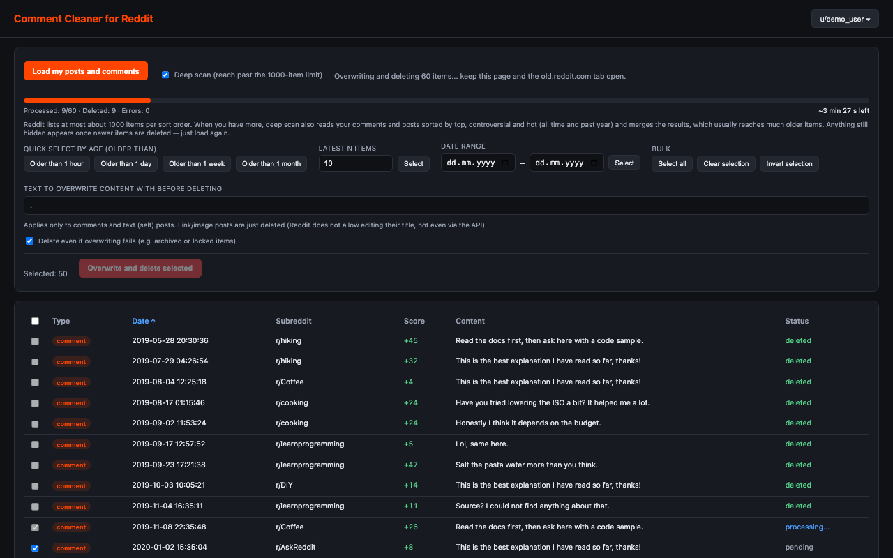

# Comment Cleaner for Reddit


A Chrome / Brave extension (Manifest V3) that loads your Reddit posts and comments, lets you sort and
select them by date, and then bulk **overwrites** and **deletes** them.



- [Privacy policy](https://rakuscinec.github.io/comment-cleaner-for-reddit/privacy-policy.html)
- [Report a problem](https://github.com/rakuscinec/comment-cleaner-for-reddit/issues)

## Features

- Loads your posts and comments into one sortable table (type, date, subreddit, score, content, status)
- Deep scan that reaches items beyond Reddit's 1000-item listing limit
- Overwrites comments and text posts with a text of your choice before deleting them
- Progress bar with an estimate of the remaining time, both while loading and while deleting
- Quick selection: older than 1 hour / day / week / month, latest N, date range, select all, invert
- Log of every action, including errors
- Optional switching between several Reddit accounts without signing out

## How it works

- The UI runs as a standalone extension page opened in a new tab. Right after it opens, it checks
  whether you are signed in to Reddit and shows the account in the top right ("Not signed in"
  otherwise).
- In the background it keeps one quiet tab on `old.reddit.com` and, through it, calls the same
  undocumented JSON API that Reddit's own web pages use, with your own sign-in. The requests run in
  the page's main world (`chrome.scripting.executeScript` with `world: 'MAIN'`), so they are exactly
  like the website's own:
  - `GET /api/me.json` – username and the `modhash` anti-forgery token,
  - `GET /user/<name>/comments.json` and `/user/<name>/submitted.json` – your comments and posts,
  - `POST /api/editusertext` – overwrites a comment or text post,
  - `POST /api/del` – deletes it.
- **The 1000-item limit.** Reddit returns at most about 1000 items (10 pages of 100) per listing and
  sort order. The extension first reads your comments and posts sorted by `new` (both in parallel).
  If a list reaches the limit and deep scan is on, it also reads that list sorted by `top` and
  `controversial` (all time and past year) and `hot`. Each sort order has its own ~1000-item window,
  so older items that are not among the newest 1000 often appear in one of them. Results are merged
  and de-duplicated by Reddit's fullname (`t1_…` / `t3_…`). Items that are still hidden show up once
  newer items are deleted – just load again.
- Up to 4 listings are read at once. Requests answered with 429 / 5xx are retried with a back-off
  (honouring `Retry-After` / `x-ratelimit-reset`), and when Reddit reports fewer than 5 requests left
  in the current rate-limit window, all workers pause until it resets.
- Overwriting and deleting is sequential with a ~1 s pause between requests. Reddit's
  "you are doing that too much" (`RATELIMIT`) errors are retried after the delay Reddit asks for.
- Link and image posts cannot be edited on Reddit, and neither can archived items, so they are deleted
  without overwriting. "Delete even if overwriting fails" (on by default) decides what happens when an
  edit is refused for another reason.

## Multiple accounts

Cookies for `reddit.com` are saved to `chrome.storage.local` when you add an account and swapped when
you switch.

1. Account button (top right) → "+ Sign in to a new account".
2. Sign in in the new `reddit.com/login` tab (you enter your password directly on reddit.com). The
   extension detects the sign-in (checks every 2 s), closes the tab and saves the account.
3. Switching accounts changes the Reddit sign-in for the **whole browser** (that profile).

## Installation from source (Chrome and Brave)

1. Clone or download this repository.
2. Open `chrome://extensions` (or `brave://extensions`).
3. Turn on "Developer mode".
4. Click "Load unpacked" → select the `extension` folder.
5. Click the extension icon – a new tab with the app opens.

Requires Chrome 116 or newer (or a Chromium browser based on it).

## Repository layout

| Path | Contents |
|---|---|
| `extension/` | The extension itself – this is what gets packaged |
| `docs/` | GitHub Pages site (project page and privacy policy) |
| `store/` | Chrome Web Store listing texts, screenshots and promo tiles |
| `assets/` | Source SVGs of the icon (`icon.svg` for 48/128 px, `icon-small.svg` for 16/32 px) |
| `scripts/build.sh` | Builds `dist/comment-cleaner-for-reddit-<version>.zip` for the Web Store |

To build the Web Store package:

```bash
./scripts/build.sh
```

## Important notes

- **Irreversible.** Overwritten and deleted content cannot be restored.
- Try it first on 1–2 old comments and check on reddit.com that they are really gone.
- With hundreds of items deleting takes a while (~2–3 s per item) – keep the extension page and the
  quiet `old.reddit.com` tab open.
- This uses Reddit's unofficial web API with your own sign-in; Reddit may change it at any time.
- Saved cookies contain sign-in session tokens – they are stored only locally in this browser and are
  never sent anywhere other than reddit.com.

Comment Cleaner for Reddit is an independent project and is not affiliated with, endorsed by or
sponsored by Reddit, Inc. Reddit is a trademark of Reddit, Inc.

## License

[MIT](LICENSE)
